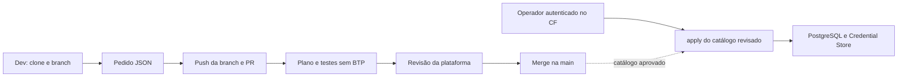

# SAP BTP Infrastructure Lab

[](https://github.com/carlosribeirodev/sap-btp-infra/actions/workflows/postgres-catalog-ci.yml)

Exercício educacional de infraestrutura declarativa no SAP BTP Cloud Foundry.
O desenvolvedor solicita PostgreSQL num arquivo JSON; a plataforma revisa a PR e
opera o provisionador. Cada app recebe banco lógico, schema e usuários de
runtime/deployer próprios numa instância compartilhada. As senhas ficam no SAP
Credential Store.

Requests e Assets são os exemplos iniciais. O código das aplicações está no
[projeto CAP](https://github.com/carlosribeirodev/sap-cap-postgres-cloud-foundry).

## Solicitar PostgreSQL

Colaboradores autorizados com **Write** usam o próprio repositório, sem precisar de
fork:

```sh
git clone https://github.com/carlosribeirodev/sap-btp-infra.git
cd sap-btp-infra
git switch -c postgres/meu-app
```

Adicionar `infrastructure/postgres/catalog/dev/<app_id>.json`. O app precisa estar
cadastrado no registro da plataforma. O passo a passo, incluindo os dois arquivos
e os comandos de push/PR, está em [CONTRIBUTING.md](CONTRIBUTING.md).



## Estado da automação

O CI executa o plano offline e 39 testes, incluindo PostgreSQL 16 efêmero, em PRs,
pushes para main e acionamento manual. A main exige CI aprovado e uma aprovação
de CODEOWNER para quem não é administrador. Somente admins podem dispensar a
revisão no merge de uma PR; o CI continua obrigatório para todos. Force push e
exclusão são bloqueados.
O fork continua disponível para contribuições externas sem permissão de escrita.

**O merge ainda não provisiona recursos no BTP.** O `apply` é operado manualmente,
com autenticação CF e destino privado, após conferir o catálogo revisado. Nenhum
secret BTP é usado pelo workflow de CI. Uma identidade técnica e um workflow de
entrega separado fazem parte de uma etapa futura.

O único CODEOWNER inicial é `CarlosRibeiro82`. Ele pode revisar PRs de outros
desenvolvedores e, como admin, mesclar suas próprias PRs sem aprovação adicional,
depois do CI. O GitHub não permite registrar uma aprovação na própria PR; a
exceção administrativa é uma dispensa de revisão. Ver [governança](docs/governance.md).

## Executar o plano local

Python 3.10+ para o plano; Node.js 24 para os testes e operação do worker.

```sh
cd infrastructure/postgres
python3 -m venv .venv
. .venv/bin/activate
python3 -m pip install -r requirements.txt
python3 provision.py plan
```

O plano não usa login CF, consulta recursos remotos ou calcula custo. O MVP de
operação aceita os perfis trial declarados e recusa fallback para plano pago.
A disponibilidade dos serviços depende da conta e região.

## Documentação

- [Contribuir e solicitar uma alocação](CONTRIBUTING.md).
- [Operar o provisionador](infrastructure/postgres/README.md).
- [CI, proteção e preparação da entrega](infrastructure/postgres/CI.md).
- [Testes e limites de validação](infrastructure/postgres/VALIDATION.md).
- [Arquitetura e responsabilidades](docs/architecture.md).
- [Integração CAP pendente e compatibilidade dos nomes](https://github.com/carlosribeirodev/sap-cap-postgres-cloud-foundry/blob/main/docs/infrastructure-catalog.md).
- [Segurança](SECURITY.md).

Licença [MIT](LICENSE).
